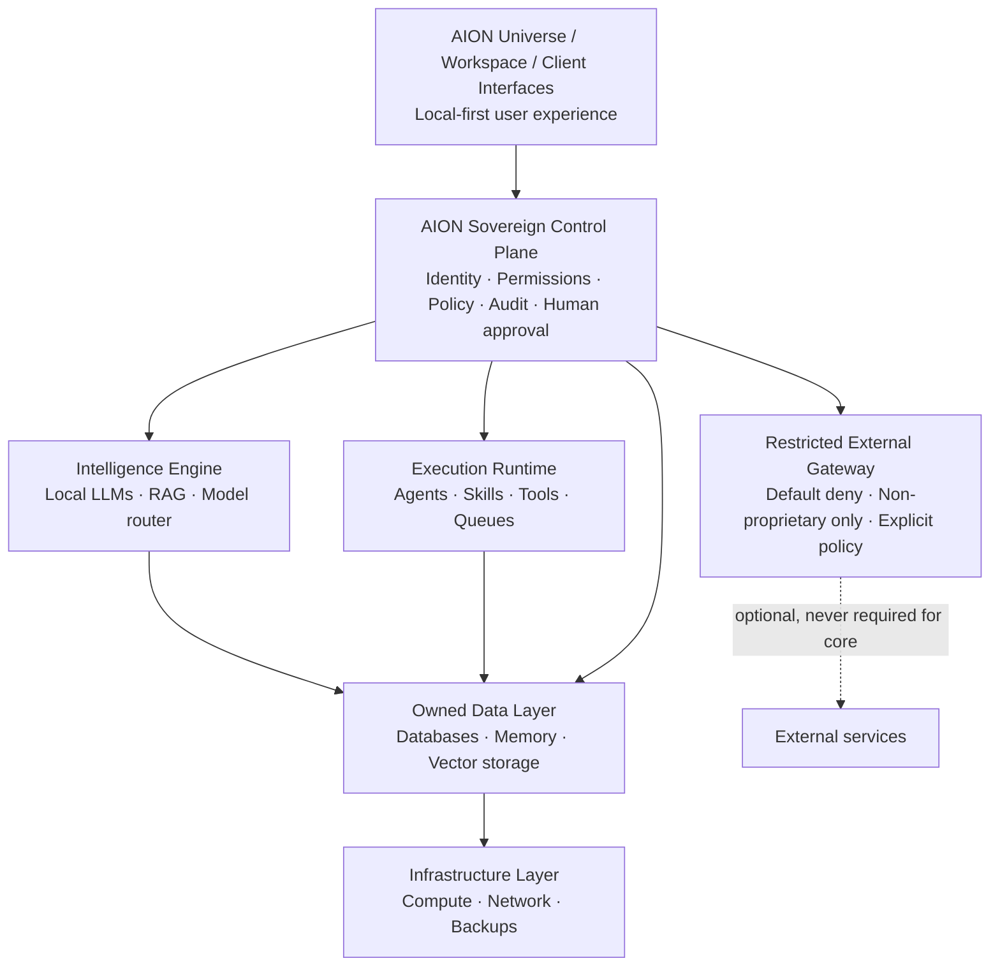

# AION Sovereign Intelligence Doctrine

> **Status:** Binding core architecture principle  
> **Adopted:** 2026-10-19  
> **ADR:** [ADR-016](../adr/ADR-016-sovereign-intelligence-doctrine.md)  
> **Program:** [roadmap/sovereignty-program.md](../roadmap/sovereignty-program.md)

This doctrine is a foundational rule for how we design AION Systems and the
entire AION Universe. It governs architecture recommendations, product designs,
agent workflows, infrastructure decisions, and development plans.

**Principle (compressed):**

> We do not rent the foundation of our intelligence. We own the infrastructure,
> preserve our knowledge, control execution, and decide when — or whether — the
> outside world participates.

---

## Objective

AION will own its data, control its intelligence, govern its execution, and
remain operational without dependence on external AI providers or cloud
platforms.

The objective is not simply to build an AI-powered company. It is to build an
**independent intelligence infrastructure** that AION owns and controls.

One important distinction: AION can own its intelligence infrastructure without
training every foundation model from scratch. Running suitably licensed
open-weight models on controlled hardware, combined with owned knowledge,
evaluation systems, and execution logic, is a practical starting point.

---

## 1. The five non-negotiable principles

### 01 — Data sovereignty

Company data, customer records, proprietary workflows, memory, knowledge, and
operational intelligence remain under AION-controlled infrastructure and
encryption keys.

### 02 — Intelligence sovereignty

Prioritize locally deployable AI models, owned context and retrieval systems,
self-hosted inference, and independent model evaluation. Frontier models cannot
become a mandatory dependency.

### 03 — Offline-first execution

Core AION operations must continue without internet access, external
authentication services, hosted databases, or public inference endpoints.
External communications can queue until connectivity returns.

### 04 — Zero unauthorized IP exposure

Public APIs are prohibited for any task involving proprietary data, internal
workflows, confidential knowledge, or company IP. External services are
permissible only when the task does not involve or require protected
information.

### 05 — Vendor independence

Every critical component must have an AION-controlled operating path, portable
data formats, documented deployment procedures, and a tested recovery strategy.

---

## 2. Target architecture

| Plane | Role |
|---|---|
| **Universe / Workspace / Clients** | Local-first user experience. |
| **Sovereign Control Plane** | Identity, permissions, policy, audit, human approval. |
| **Intelligence Engine** | Local LLMs, RAG, model router — owned context and retrieval. |
| **Execution Runtime** | Agents, skills, tools, queues — offline-capable where critical. |
| **Owned Data Layer** | Databases, memory, vector storage under AION keys. |
| **Infrastructure Layer** | Compute, network, backups AION controls. |
| **Restricted External Gateway** | Default deny. Only non-proprietary tasks. Explicit policy checks. |

**External services are optional extensions, never required for core
operations.**

Mapping to existing layers and repos:

| Doctrine plane | Existing AION home |
|---|---|
| Sovereign Control Plane | `aion-core` + [control-plane.md](control-plane.md) + [governance/](../governance/README.md) |
| Intelligence Engine | [intelligence-layer.md](intelligence-layer.md) + model-router capability |
| Execution Runtime | `aion-runtime` + [execution-layer.md](execution-layer.md) |
| Owned Data Layer | `aion-data` + [data-layer.md](data-layer.md) |
| Infrastructure Layer | `aion-infra` |
| Restricted External Gateway | Execution Gateway policy path ([ADR-003](../adr/ADR-003-execution-gateway-into-runtime.md)) + outbound IP policy |

---

## 3. Immediate impact on the current stack

Existing integrations do **not** automatically meet this policy. They need an
**exposure audit and a controlled migration**, not an untested shutdown.

| Component | New direction |
|---|---|
| **Supabase** | Migrate critical data and services toward self-hosted, AION-controlled infrastructure. |
| **Vercel** | Keep as a temporary delivery layer where appropriate; develop a self-hosted deployment path. |
| **Grok / Claude / frontier models** | Public API inference prohibited for proprietary tasks; replace core reliance with local inference. |
| **AION Runtime** | Establish offline-capable execution, queues, policy enforcement, and local recovery. |
| **Agent memory / RAG** | AION-owned storage and retrieval infrastructure. |
| **GHL / third-party CRM** | Explicitly authorized external integrations — not the system of record for protected intelligence. |
| **AI development tools** | Restrict access to protected repositories, architecture, source code, and confidential operational context. |

Prior ADRs that selected hosted vendors (for example analytics or hosting paths)
remain historically valid until superseded; new work must satisfy this doctrine's
[acceptance gate](#5-architecture-acceptance-gate), and migration work proceeds
through the [sovereignty program](../roadmap/sovereignty-program.md).

---

## 4. Implementation priorities

| Phase | Name | Focus |
|---|---|---|
| **Phase 1** | Sovereignty audit (P0) | Inventory every provider, outbound API, data dependency, model dependency, credential, and possible IP exposure. |
| **Phase 2** | Independent core | Deploy self-hosted identity, persistence, inference, execution queues, secrets management, and audit logging. |
| **Phase 3** | Offline operation | Test AION with internet disconnected. Critical internal missions, agent inference, retrieval, and approvals must remain operational. |
| **Phase 4** | Sovereign intelligence optimization | Locally deployable specialized models, permissioned knowledge retrieval, evaluations, and fine-tuning where economically justified. |
| **Phase 5** | Portable customer infrastructure | Package AION deployments for customer-controlled servers, private clouds, and on-premises environments. |

Detailed backlog and ownership:
[roadmap/sovereignty-program.md](../roadmap/sovereignty-program.md).

---

## 5. Architecture acceptance gate

Every future AION development proposal that touches critical capability must
answer:

1. **Does this expose or require company IP outside AION’s controlled boundary?**
2. **Can it execute its core functionality with no internet?**
3. **Can we replace its AI model without rebuilding the workflow?**
4. **Do we control its authoritative data, encryption keys, and execution history?**
5. **Can we restore and operate it after a provider shutdown?**

Any critical component that fails these checks is **noncompliant** until
redesigned or **explicitly classified** as an optional, non-proprietary external
function.

Optional external functions must:

- be reachable only through the Restricted External Gateway;
- carry explicit policy allowing the call;
- never be required for core operations;
- never receive proprietary data, internal workflows, confidential knowledge, or
  company IP.

---

## Relationship to existing principles

This doctrine **extends** — it does not replace —
[engineering/principles.md](../engineering/principles.md):

| Existing principle | How sovereignty reinforces it |
|---|---|
| Mission before infrastructure | Sovereignty work proceeds in phased missions; no speculative multi-cloud sprawl. |
| Orchestration ≠ execution | Model and vendor swap at the execution/intelligence seam, not inside workflows. |
| Human authority | Control plane retains policy, audit, and approval offline. |
| Explicit ownership | Authoritative data and keys have one AION-controlled owner. |
| Capabilities over vendors | Frontier APIs are optional adapters, never the foundation. |

---

## Enforcement

- **Architect** reviews proposals against the acceptance gate.
- **Security Engineer** owns IP-exposure and outbound-gateway policy.
- **Infrastructure Engineer** owns self-hosted paths, keys, and recovery drills.
- **AI / Agent Engineer** owns local inference routing and eval independence.
- **Documentation Engineer** keeps this doctrine and the program roadmap current.

Changes that weaken sovereignty for convenience are **architectural drift** and
must be rejected or recorded as an explicit, time-bounded exception ADR.
