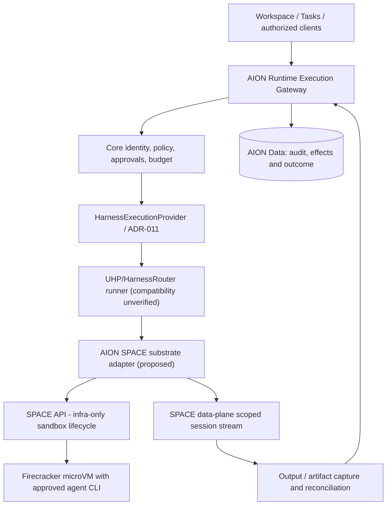

# AION SPACE — Firecracker Execution Substrate Evaluation (RFC)

**Status:** Proposal / nonproduction research only. **Date:** 2026-10-15. **Scope:** Execution-host isolation layer, NOT a new AION execution authority.

- Upstream: [perplexityai/SPACE](https://github.com/perplexityai/SPACE), [Apache-2.0 license](https://github.com/perplexityai/SPACE/blob/main/LICENSE), [SPACE guide](https://space.docs.perplexity.ai/guide/).
- AION coordination: [Execution Host program P-AIO-8](https://linear.app/aion-empire/project/aion-execution-host-and-session-continuity-abbe7168ebe6), [AIO-72 harness backend comparison](https://linear.app/aion-empire/issue/AIO-72/eh-001-compare-cloudroom-core-with-existing-uhpharnessrouter-approach), [AIO-76 containment assurance](https://linear.app/aion-empire/issue/AIO-76/eh-005-sandbox-isolation-deny-egress-revocation-and-resource-assurance), [OpenShell candidate AIO-26](https://linear.app/aion-empire/issue/AIO-26/implement-isolated-aion-runtime-adapter-with-openshell-sdk).
- Production priority: GE-001 [AIO-37](https://linear.app/aion-empire/issue/AIO-37/p0-certify-ge-001-on-a-fresh-low-risk-real-record) and Pilot-to-Revenue remain P0; this RFC does not approve environment provisioning or deployment.

## Thesis

Perplexity SPACE is an HTTP-managed platform for Firecracker microVM sandboxes. This is **execution isolation infrastructure**: it owns templates, VM lifecycle, guest processes, command streams, snapshots and host-side management. It is not a task manager, not an LLM agent harness and not an AION policy/approval gateway. Its own management API/DB is *internal infrastructure state*, not authoritative AION business execution or outcome data.

**Do not replace:** AION Runtime/SEL ([ADR-012](../adr/ADR-012-secure-execution-layer-v1.md)), AION Core's [HarnessExecutionProvider](https://github.com/Ceoloo/aion-core/blob/main/src/ports/harness-execution-provider.ts), or accepted [ADR-011](../adr/ADR-011-harness-execution-seam.md) (UHP/HarnessRouter as replaceable harness backend).

**Preferred study direction:** evaluate a SPACE-provisioned sandbox as the **isolation substrate** hosting a native harness / HarnessRouter Runner. This is a design hypothesis, **not a verified HarnessRouter-on-SPACE implementation**. Do not add a second permanent harness router, alternate Runtime gateway or unmanaged host command channel. Compare SPACE to the preexisting OpenShell proposal before choosing one infrastructure substrate.

## Ownership and flow

Core does not import SPACE-specific SDKs. Infra owns deployment, firecracker host privileges, templates, credentials, egress, telemetry, placement and rollback. Runtime composition-root integration remains an explicitly versioned, fail-closed adapter behind the approved interface. AION Workspace shows real session/sandbox status only through authenticated AION endpoints, not raw SPACE management credentials.

## API integration sequence to test

1. Receive a **policy-authorized**, tenant-bound, low-risk request in AION Runtime. Assign immutable request/run/execution IDs, scoped workspace artifacts, budget, timeout and stable idempotency key; check disabled-by-default feature gate.
2. Resolve an **immutable template digest** to a narrow vCPU/memory/disk shape and an explicit network policy. Use an isolated sandbox per tenant/task unless review approves bounded safe reuse. Include only non-secret attribution metadata.
3. `POST /v1/sandboxes` with stable idempotency key. Persist sandbox ID, operation ID and request fingerprint in AION's reconciliation state; **accepted is not ready**.
4. Poll operation to success, inspect sandbox state `running`, and check guest process endpoint readiness. Treat each as separate facts; record template digest and resource shape.
5. Create command session with deterministic command input/timeout; persist command session/process identity and key. Attach using SPACE's **session-scoped data-plane attachment token** (not the SPACE management bearer token); attachment starts execution.
6. Capture bounded stdout/stderr/events, sanitize secrets/PII, persist a transcript/artifact ref to a durable AION-controlled store. SPACE event streaming is **not durable replay**; resync-required or dropped stream is not evidence of a completed command.
7. Require an explicit `process_exited` result plus expected exit code, artifact verification and AION policy/outcome checks before marking execution success. An operation success or closed stream is not command success.
8. Stop/cancel or cleanup with a stable original key; delete sandbox and poll the delete operation. Quarantine uncertain cleanup or failure to terminate descendants; alert and fence further reuse. VM snapshots are not audit log backups.
9. Correlate tenant, mission, execution, agent, task, sandbox, operation, session, process, template digest, transcript, costs and cleanup evidence. Do **not** copy product data or secrets into AION Data.

### Important retry boundary

SPACE has idempotency semantics for certain management and command requests, but **it does not guarantee exactly-once external effects made by a guest process**. A timeout, stream interruption or `resync_required` may mean work already ran. Preserve original keys/identities; inspect/reconcile, do not create a fresh session or replay a mutation blindly. Dispatched ambiguous work remains AION `indeterminate`.

## Infrastructure prerequisites and real constraints

- Documented Kind quickstart needs **apt-based Linux x86_64 with /dev/kvm, /dev/net/tun, loop devices, btrfs and privileged Docker**, and specific admin/bootstrap dependencies; it does **not** run directly on macOS. Verify host virtualization support and vendor VPS restrictions; do not assume the current AION VPS can host it.
- Kubernetes/Kind is the documented quickstart, not a universal requirement: SPACE has a *direct worker adapter*. A production-grade direct deployment is **not validated by the Kind installation guide**; document control/worker placement, storage and recovery before selecting either mode.
- SPACE has its own PostgreSQL desired-state DB, controllers/worker services, template/snapshot object store, data plane and operator identity management. Budget for HA, backups, patching, privileged VM host services and incident response. It is **not** a replacement for AION Data.
- Network boundary: the documented Kind sandbox network policy permits public IPv4 egress and DNS. AION must enforce verified **default-deny guest egress** with narrowly audited DNS and allowlisted destinations through SPACE network policy plus host/cluster boundaries. Merely enabling named additive egress profiles does not assert default-deny.
- Only server-side AION Infra retains SPACE management tokens. SPACE data-plane attachment tokens are scoped to a command session; never expose either token to the browser, task database, agent prompts, logs or client-side Next.js code.
- SPACE's documented public baseline is **0.8.0 pre-1.0**, with a future minor breaking-change path; pin reviewed Git commit/release, kernel, templates, host/guest compatibility and image digests. Test restore and rollback compatibility, not just upgrade success.
- Templates, snapshot data and guest files may carry client data. Encrypt storage, constrain access, set TTL, require secure deletion policy and prohibit unsupported snapshot exports.
- Apache 2.0 allows commercial reuse subject to license and applicable notice/patent/third-party obligations; review dependency licenses and retain required attribution and modified-file notices.

## Compare substrate options before adoption

| Candidate | Core strength | Cost / risk | Proof required |
| --- | --- | --- | --- |
| Existing Docker / process isolation | Lowest change cost | Weakest adversarial isolation; privileges and egress critical | Tenancy/security acceptance and code-execution risk |
| OpenShell proposal (AIO-23–29) | Existing AION backlog candidate for sandboxed agents | Status and actual isolation not production-proven | Security guarantees, SDK fit, runtime proof, operating cost |
| SPACE Firecracker | VM-based workload boundary, command/lifecycle API, suspend/restore, templates | KVM privilege, complex control/worker plane, pre-1.0 compatibility, cost | Working host, network/tenant tests, UHP runner mapping, crash handling |

**Decision rule:** one chosen isolation substrate per task risk class in initial production; keep the underlying provider replaceable. SPACE may eventually be selected for higher-risk untrusted code, but no dual permanent cluster rollout without a reviewed need.

## Staged engineering plan

**SP-001 — Architecture / host feasibility, research only**
- Pin version, license and dependency review; compare OpenShell, Docker, SPACE.
- Probe availability (only in authorized nonprod host): Linux x86_64, KVM, tun/loop/btrfs, nested virtualization; estimate CPU/RAM/storage, VM lifecycle overhead, network operations, ongoing costs.
- Specify whether UHP Runner can be placed inside SPACE VM or needs adapter; demonstrate wire protocol before claiming compatibility.
- Deliver go/no-go ADR proposal; no platform commitment from this RFC.

**SP-002 — SPACE backend contract & threat model, research only**
- Map management vs data-plane token, template/VM/session/operation lifecycle to AION's `HarnessRunRequest` and outcome states.
- Design stable idempotency and reconciliation, kill/revoke, artifact retention, checkpoint and guest stream loss.
- Record tenant-bound egress deny, DNS/DoH, SSRF/metadata/IP, host privilege and secret isolation tests.
- Integrate threat controls with EH-002/EH-005 rather than inventing new authority.

**SP-003 — Disposable sandbox acceptance, gated**
- **Only after GE-001 AIO-37 acceptance, SP-001/002 reviews, infrastructure maintainer authorization and dedicated test host.**
- Bring up a nonproduction SPACE deployment on supported Linux. One sandbox, immutable template, allowlist-only network, restrictive resources; perform harmless `printf` and a disposable file edit through the API.
- Verify create, readiness, attach, `process_exited`, streamed capture, artifact checksum/ref, pause/suspend/wake, deletion, orphan isolation and complete cleanup.
- Simulate lost request/stream, `resync_required`, duplicate keys, AION `indeterminate`, kill switch, tenant-cross-access, metadata reachability, denied internet and secret leak. Separate measured evidence from fixtures.
- Stop and roll back without touching production or live client data; record cost per minute, cold start, warm-pool benefit only if measured.

**SP-004 — Integration / controlled rollout, separately authorized**
- Select substrate by security/economics evidence. Version any changed interface via architecture review.
- Integrate Runtime-backed session/missions evidence behind kill switch, run staging and failure rehearsals; no direct SPACE API from Workspace.
- Pinned artifacts, rollback, telemetry, security review and explicit maintainer production deployment decision; GE-001 remains independently certified. Never call it live/available from an RFC or CI pass.

## Explicit exclusions

No direct installs on current production VPS, no KVM host admin commands without owner/maintainer authorization, no customer credentials, no arbitrary internet, no multi-client SaaS availability, no self-service code execution, no new top-level control plane and no automatic PR merges/deployments. Existing EH-001–007 and P0 revenue/GE-001 work remain primary; this is a **candidate substrate** for their sandbox requirement.

## Canonical upstream reading

- [SPACE architecture](https://space.docs.perplexity.ai/guide/architecture.html)
- [SPACE first sandbox](https://space.docs.perplexity.ai/guide/first-sandbox.html)
- [SPACE installation](https://space.docs.perplexity.ai/guide/installation.html)
- [SPACE egress profiles](https://space.docs.perplexity.ai/guide/egress-profiles.html)
- [SPACE native API hardening](https://github.com/perplexityai/SPACE/blob/main/docs/native-api-hardening.md)
- [SPACE versioning](https://github.com/perplexityai/SPACE/blob/main/docs/versioning.md)
