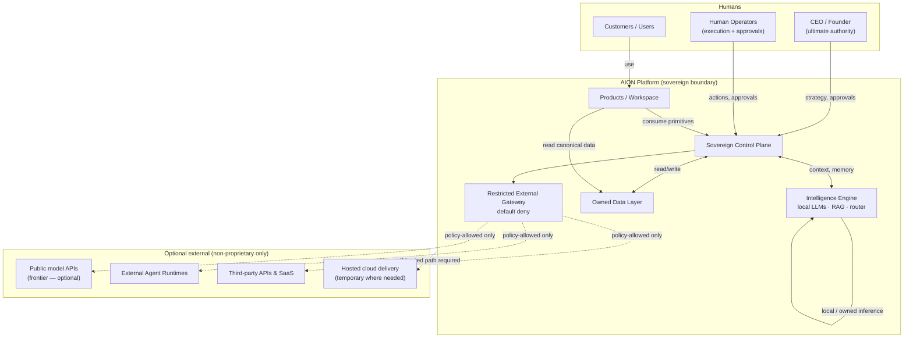

# System Context

This document draws the boundary of AION: who and what sits outside it, and how
they interact with it. It is the outermost view — one level above
[logical-architecture.md](logical-architecture.md).

## External actors

| Actor | Relationship to AION |
|---|---|
| **CEO / Founder** | Holds ultimate authority. Sets strategy; approves financial, destructive, and high-risk actions via [human gates](../governance/human-gates.md). |
| **Human operators** | Execute work AION routes to them and grant approvals at gates. They are a first-class execution environment, not an afterthought. |
| **Customers / users** | Interact only with **products**, never with the control plane directly. |

## External systems

| System | Role | Coupling rule |
|---|---|---|
| **Local / owned model runtimes** | Primary inference for proprietary work. | Required path for core intelligence ([doctrine](sovereign-intelligence-doctrine.md)). |
| **Public model providers** | Optional inference for **non-proprietary** tasks only. | Never mandatory; never receive protected IP. |
| **External agent runtimes** | Claude Code, Cursor, Codex, Grok, Kimi/OpenClaw, etc. Perform execution work. | Interchangeable behind a common interface; protected IP restricted. |
| **Third-party APIs / SaaS** | CRMs, payment, comms, analytics vendors. | Explicitly authorized externals; never system of record for protected intelligence. |
| **Cloud / hosted delivery** | May host temporarily; self-hosted path required. | Infrastructure supports the architecture; it does not dictate it. Owned by `aion-infra`. |

## Boundary rules

1. **Customers touch only products.** The control plane, intelligence, and data
   layers are internal.
2. **External runtimes are pluggable.** No AION logic assumes a specific agent
   runtime or model. See [execution-layer.md](execution-layer.md).
3. **Every external call is a governed tool call** through the Restricted
   External Gateway (default deny). It carries identity, permissions,
   observability, and an IP-exposure check. See
   [security-model.md](security-model.md) and
   [sovereign-intelligence-doctrine.md](sovereign-intelligence-doctrine.md).
4. **No external system owns canonical business entities.** AION mirrors what it
   needs into `aion-data` with explicit ownership. See
   [data-layer.md](data-layer.md).
5. **Core operations remain viable offline.** External communications may queue
   until connectivity returns.
