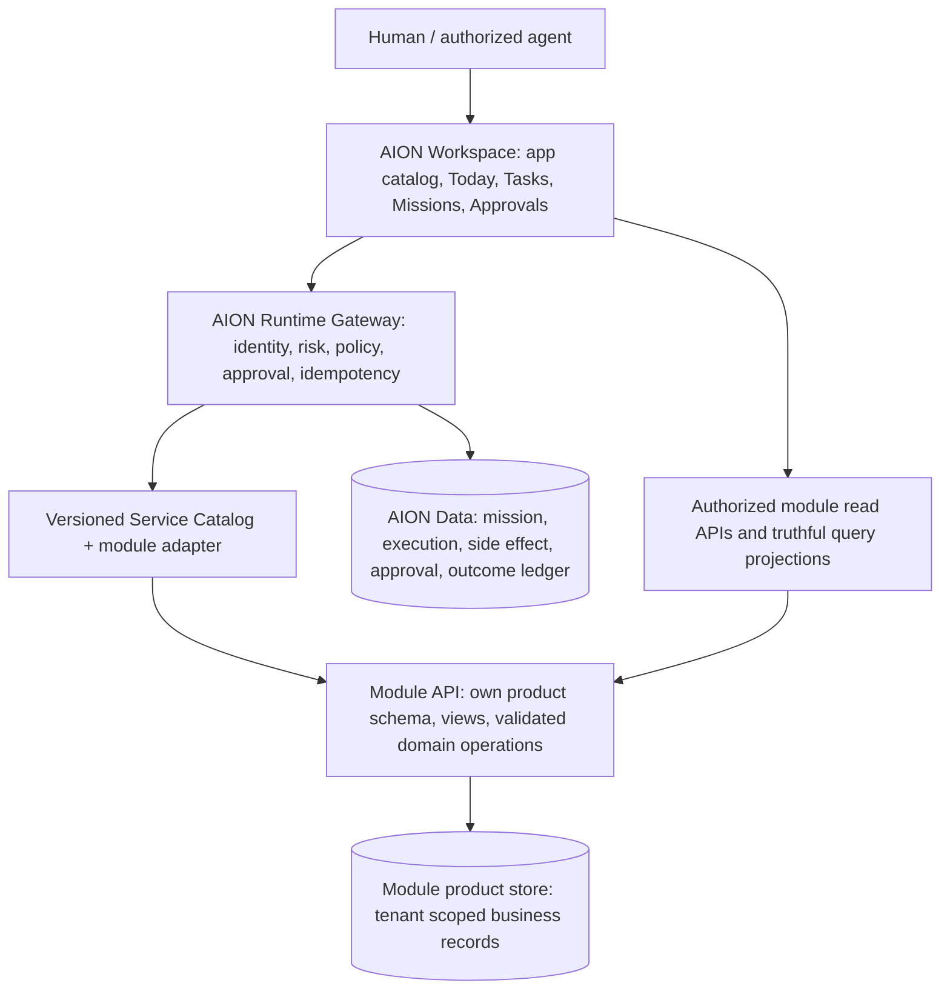

# ERP.ai Reference Patterns for AION's Modular Business OS

**Status:** External research / PROPOSED reference, documentation only. **Reviewed:** 2026-10-15.

**Source of evidence:** ERP.ai's *public-facing website*, not a source-code audit, installed instance, API integration test, security assurance, or license to copy site assets. [Homepage](https://www.erp.ai/) · [Platform](https://www.erp.ai/platform) · [Workflows](https://www.erp.ai/workflows) · [Pricing](https://www.erp.ai/pricing) · [Agent permissions example](https://www.erp.ai/procurement-system/agent).

## Decision in one sentence

Borrow the **mental model** of a common programmable business-application foundation serving both people and agents; keep AION's established boundaries: Workspace as the operator surface, Runtime/Core as sole execution and authorization authority, AION Data for governance, and separately owned product/module data. **Do not create an ERP monolith, generic app builder, or second control plane.**

## Observed website patterns versus AION adaptations

| Public ERP.ai positioning / demo | AION analogue | Priority | Guardrail |
| --- | --- | --- | --- |
| App catalog of CRM, Projects, Procurement, ITSM and other business systems | One AION Workspace app registry with module owner, state, domain, accepted services and service health | P1 design | `planned` stays planned; don't imply availability |
| Shared typed records, forms, views, API and agent guide derived from an app model | Module-local schema and validators generate **scoped** read/UI metadata and versioned Service Catalog contract | P1 research | Schema changes do not automatically authorize agent writes; no central unrestricted CRUD |
| Human / agent access through the same org/roles/resource-owner checks | Authenticated Runtime principal, tenant, actor-role and module policy; client grants server-side | P0 invariant | Never use browser role/tenant claims; module owns domain validity |
| Configurable workflow, node input/output, replay-oriented history, version and approvals | AION Missions **read-only Run Explorer**, stage receipts, artifacts, reviewed proposals, recovery & event timeline | P2 UI | Runtime remains executor; `indeterminate` is not success or safe replay |
| Agent prompt/skill.md plus API-first service access | Versioned **AION Capability Manifest** and guided agent onboarding, generated from approved Service Catalog | P1 design | No remote `curl | bash`, arbitrary shell installs, or auto-authorized tools |
| Customer portals and live-record reporting | Client service/status portal: proposals, onboarding, deliverables and evidence linked to real records | P2 | Requires client identity, permission checks, truthful source modes |
| Start with one process and a role-specific template | Productized contractor **Revenue-to-Onboarding blueprint** | P1 bounded pilot | Prove baseline and KPI outcome; do not launch a generic vertical ERP suite |
| Published API/automation/AI rates, usage receipts | Cost and value receipts: metering, model, tool, infrastructure, approvals, verified outcome | P2 research | Evaluate AION unit economics first; ERP.ai public prices are not AION prices |

**Read critically:** the website's advertised system breadth and illustrated workflows are *vendor claims/demonstrations*. Technical completeness, model consistency, production resilience, tenant guarantees, cost and actual customer utility were not independently tested.

## AION architecture fit



**Explicitly preserve** accepted Runtime/SEL authority architecture and the **proposed** [ADR-015 Product Module Contract](../adr/ADR-015-workspace-product-module-contract.md) / [module contract](../architecture/product-module-contract.md). The schema-driven UI/tool-generation pattern is a future implementation option **within** the module. It is not a new permission engine or a mandate to replicate every product table into AION Data. Do not assume ADR-015 is accepted.

## Bounded reference contract to investigate — not a released manifest

```json
{
  "appId": "revenue",
  "displayName": "AION Revenue",
  "availability": "planned",
  "dataOwner": "revenue-module",
  "schemaVersion": "proposed-v0",
  "serviceRefs": ["revenue.lead.followup@1"],
  "requiredRoles": ["invoke"],
  "humanApprovalPolicy": "Runtime-defined",
  "moduleCapabilities": ["records.read", "proposal.prepare"],
  "actionsAreAuthorizedOnlyVia": "aion-runtime"
}
```

This illustration must **not** be registered as a live catalog entry or treated as a verified versioned service. Real schemas, capabilities, actor grants and availability come only from reviewed Runtime/module contracts and passing acceptance.

## First product test — one service vertical, not a suite

**Candidate:** Contractor Lead-to-Onboarding, aligned with AION's existing sales/revenue wedge.

1. Ingest/identify the source lead and permissioned contact.
2. Review audit/diagnosis inputs with source references.
3. Prepare a qualified opportunity, scoped work and proposal draft.
4. Route any client-facing outreach, commercial changes or publication through Runtime policy/human approvals.
5. On approved won deal, hand off an onboarding task and the record links to the operator, preserving who owns each system of record.
6. Capture observable evidence: response times, handoffs, approved artifacts, task statuses versus actual mission outcomes, delivery hours, and **collected** revenue where available.

**Potential success criteria for research, not committed targets:** one real tenant-scoped workflow completes with verified artifact and audit reference, no cross-tenant access, no unapproved outbound side effects, stable idempotency on retry, and an honest measured time/cost baseline. Existing [GE-001 AIO-37](https://linear.app/aion-empire/issue/AIO-37/p0-certify-ge-001-on-a-fresh-low-risk-real-record) and Pilot-to-Revenue gate the engineering rollout; this study must not delay them.

## Sequencing

**Now (documentation / fit):**

- Keep this as a research reference; validate webpage claim against any deeper technical docs before assigning implementation.
- Compare to the [Workspace shell](https://github.com/Ceoloo/AION-Command-Center/blob/main/PRODUCT.md), [Tasks RFC](https://github.com/Ceoloo/AION-Command-Center/pull/10) and Creative OS under ADR-015.
- Design a **read-only capability discovery** experience without building a dynamic app generator.

**Later, after GE-001 and customer pilot evidence:**

- Choose one approved domain module; ship a genuinely useful catalogue card and read-only agent capability manifest.
- Scope a read-only Mission Run Explorer showing actual per-step evidence without exposing secrets or confusing previews with live state.
- Evaluate a limited client status portal and cost receipts with customer-owned approvals.

**Deferred / out of scope:**

- Payroll/ledger/tax products, HR ERP, manufacturing suite, low-code runtime schema mutations, generic self-service builder, open marketplace, ERP.ai integration, importing its business templates or marketing pricing.
- Unreviewed remote skills installation (especially piping installer network output into a shell). Use signed, pinned, user-reviewed distribution for AION artifacts.

## Sources & AION cross-links

- ERP.ai [platform](https://www.erp.ai/platform) for typed models, resource checks, workflow/audit and shared surfaces.
- ERP.ai [workflows](https://www.erp.ai/workflows) for nodes, approvals, step-level history, and versioned illustrative flows.
- ERP.ai [home](https://www.erp.ai/) for catalog breadth and skill onboarding examples.
- ERP.ai [pricing](https://www.erp.ai/pricing) for the observed human/manual versus API/automation metering approach; no pricing adoption.
- ERP.ai [procurement/agent](https://www.erp.ai/procurement-system/agent) for scoped agent role guidance.
- [Product Module Contract](../architecture/product-module-contract.md) / [ADR-015 proposed](../adr/ADR-015-workspace-product-module-contract.md).
- [AION Product & Software Foundry](https://linear.app/aion-empire/project/aion-product-and-software-foundry-be7252c7cda6).
- [AION Task Management scaffold PR #10](https://github.com/Ceoloo/AION-Command-Center/pull/10).
